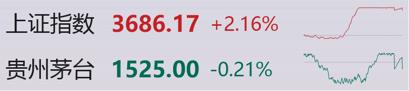
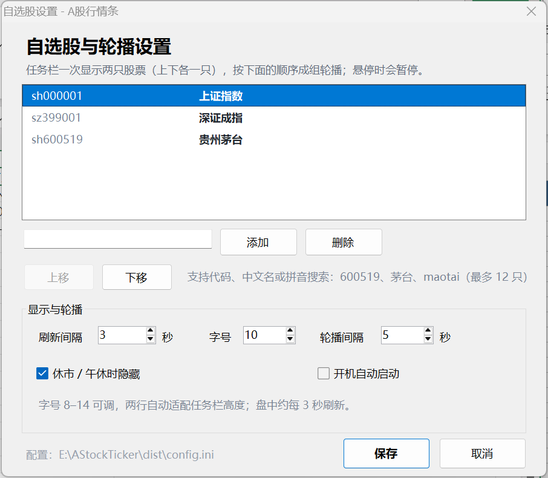

# A股行情条 · 任务栏透明版

在 Windows 11 任务栏的空白处，用 **上下两行** 同时显示两只自选股：每行左侧是名称、右侧是当前价格、涨跌幅和今日分时走势缩略图。价格红色表示上涨、绿色表示下跌、灰色表示平盘。自选股多于两只时，按设定的间隔成组轮播（每次两只），鼠标悬停时暂停。



> 上图展示程序在真实任务栏上的显示效果（150% 缩放，图中为演示数据）。文字是透明背景，直接叠在任务栏上，没有额外的黑框或悬浮窗。

---

## 它是怎么“进”任务栏的？

Windows 11 没有公开的第三方任务栏插件接口（Windows 10 的 deskband 已被移除），直接修改 Explorer 风险很高。

本程序采用的方式是：

- 创建一个 **透明、置顶、与任务栏等高** 的覆盖层；
- 把它精确放在任务栏 **托盘左侧的空白区域**，宽度按文字内容自适应；
- 背景完全透明，只绘制股票名称和价格；
- 不修改 Explorer、不注入进程、不注册 shell 扩展。

视觉上它就在任务栏里，任务栏按钮、时钟、托盘图标都照常使用；任务栏自动隐藏或进入全屏时，它也会跟着隐藏。

---

## 功能

- **上下两只**：上行一只、下行一只，每行名称在左、价格、涨跌幅和今日分时走势缩略图在右，紧凑排列，不占地方。
- **字号可调**：设置里 8–14 档；也可以右键 → `字体大小`，或按住 `Ctrl` 滚动鼠标滚轮。
- **价格即涨跌**：红涨、绿跌、灰平，价格、涨跌幅和走势线同色，一眼判断方向。
- **黑白显示**：觉得红绿太扎眼？右键勾选 `黑白显示`，价格、涨跌幅和走势线一键变为与名称相同的黑色（深色任务栏下为白色），设置会记住。
- **隐私模式**：右键勾选 `隐私模式` 后，鼠标不在行情条上时内容自动蒙上一层毛玻璃，模糊四周淡出、中间最浓，完全看不清；鼠标移入毛玻璃平滑淡出、移走再平滑淡回。模糊浓度有 `淡 / 中 / 浓` 三档，在右键 `模糊浓度` 里选择。
- **今日分时走势缩略图**：每行行末绘制当天分时线（约每 3 分钟更新一次），并以灰色虚线标出昨收基准，涨跌一目了然；北交所代码暂无分时数据或网络不可用时自动省略。
- **港股与 ETF**：A 股、港股、恒生指数、沪深 ETF、LOF 可混排轮播，共用同一套设置。
- **美股与盘前盘后**：美股常规交易（美东 09:30–16:00）之外，**盘前 04:00–09:30、盘后 16:00–20:00 也会显示**，价格旁带一个柔和的 `盘前` / `盘后` 小标签，按行情时间戳自动判断；夏令时切换自动处理。
- **按市场时段显示**：每只股票按自己市场的交易时段判断显示——A 股 / 港股休市或午休时该只隐藏，美股在盘前、盘中、盘后之外隐藏，不显示过期价格；勾选设置里的 `全时间段显示` 后才始终显示。
- **托盘悬停总览**：鼠标悬停在任务栏托盘的本程序图标上约半秒，会弹出全部自选的悬浮列表：交易中的排在前面，休市的排后面并变灰，`hk` / `us` 小标签区分市场，美股盘前 / 盘后标注在行内。
- **成组轮播**：自选股多于两只时，按列表顺序每次切换到下一组（两只），默认 5 秒，可调 2–30 秒；只有一两只时不轮播。
- **悬停暂停**：鼠标移到文字上时暂停轮播，方便看清；移开后继续。
- **手动切换**：右键 → `下一组` 立即切换。
- **按市场逐只隐藏**：午休、15:00 收盘后、周末、节假日，休市的那只自动从轮播中隐藏，不显示过期价格；所有市场都休市时整个行情条隐藏。
- **托盘控制**：托盘图标仍在，双击显示/隐藏，右键打开菜单；悬停可查看全部自选（见上方「托盘悬停总览」）。
- **右键菜单**：显示/隐藏、下一组、字体大小、黑白显示、隐私模式、模糊浓度、立即刷新、自选股设置、打开配置、开机自启、关于、退出。
- **双击看行情**：双击某一行的文字，用浏览器打开该行股票的腾讯行情页。
- **高 DPI**：适配 100%–200% 缩放。
- **便携**：配置在 exe 同目录的 `config.ini`，不写注册表（开机自启除外）。

---

## 快速开始

1. 解压整个文件夹到可写目录，例如 `D:\Tools\AStockTicker`。
2. 双击 **`AStockTicker.exe`**。
3. 行情会出现在 **任务栏托盘左侧**。若当前休市，则不会显示。
4. **右键文字** → `自选股设置...`，输入代码、中文名或拼音（如 `600519`、`茅台`、`maotai`）→ 会弹出候选列表，点选或按回车添加 → 保存。
5. 右键 → `退出` 可完全关闭。

> 首次运行如遇 SmartScreen，点“更多信息” → “仍要运行”。  
> 托盘图标可能在任务栏的 `^` 溢出区里。

---

## 交易时段与显示规则

时间均为 **北京时间**，自动按中国时区计算，与系统时区无关（美股时段按美东时间，见下文）。

每个市场独立判断：**轮播中的每只股票只在自己的可显示时段内出现**。例如 A 股午休时，上证指数这一只从轮播中隐藏，港股交易中则照常轮播；两边都不可显示时整个行情条隐藏。

| 时间段 | 状态 | 该只显示 |
| --- | --- | --- |
| 09:15 – 09:25 | 集合竞价 | 显示 |
| 09:25 – 09:30 | 待开盘 | 显示 |
| 09:30 – 11:30 | 交易中 | 显示 |
| 11:30 – 13:00 | 午间休市 | **隐藏** |
| 13:00 – 14:57 | 交易中 | 显示 |
| 14:57 – 15:00 | 收盘竞价 | 显示 |
| 15:00 后 / 周末 / 节假日 | 已收盘 / 休市 | **隐藏** |

- 隐藏时，托盘图标仍在；托盘悬浮提示不显示价格。
- 如果希望休市时也保留最后价格，可在设置里勾选 **`全时间段显示`**。
- 2025–2026 年休市安排已内置；2027 年可编辑 `holidays.txt` 补充。

### 港股（HKEX）时段

| 时间段 | 状态 | 该只显示 |
| --- | --- | --- |
| 09:00 – 09:30 | 开市前竞价 | 显示 |
| 09:30 – 12:00 | 交易中 | 显示 |
| 12:00 – 13:00 | 午间休市 | **隐藏** |
| 13:00 – 16:00 | 交易中 | 显示 |
| 16:00 – 16:10 | 收盘竞价 | 显示 |
| 16:10 后 / 周末 / 港股休市日 | 已收盘 / 休市 | **隐藏** |

- 港股休市日（与内地不同的假期）不单独内置，程序会在行情停止更新后自动隐藏，与 A 股节假日逻辑一致。
- **港股免费行情延迟约 15 分钟**，价格跳动比实际盘口晚，仅供参考。

### 美股（NYSE / NASDAQ）时段

| 美东时间 | 状态 | 该只显示 |
| --- | --- | --- |
| 04:00 – 09:30 | 盘前 | **显示**，价格旁有 `盘前` 小标签 |
| 09:30 – 16:00 | 交易中 | 显示 |
| 16:00 – 20:00 | 盘后 | **显示**，价格旁有 `盘后` 小标签 |
| 20:00 后 / 周末 / 美市假日 | 已收盘 / 休市 | **隐藏** |

- 美东与北京的时差随夏令时变化（夏令时 +12 小时、冬令时 +13 小时），程序按美东时区自动处理，每年 3 月第二个周日进入夏令时、11 月第一个周日结束。
- 美股只在盘前、盘中、盘后三个时段内显示；美东 20:00 后（约北京时间上午）该只自动隐藏。勾选 `全时间段显示` 后始终显示。
- 标签按行情时间戳判断：价格来自盘前/盘后时段就带标签；常规时段价格不带标签。
- 美股休市日（感恩节、圣诞节等）不单独内置，行情停止更新后自动隐藏。
- 美股行情可能有延迟（免费数据源），仅供看盘参考。

---

## 轮播与显示设置



- **自选股列表**：输入框支持代码、中文名、拼音搜索，输入时实时弹出候选列表；
  鼠标点选或 `↑` `↓` + 回车添加，直接回车添加第一个候选，`Esc` 收起候选。
- **刷新间隔**：1–30 秒，默认 3 秒。
- **字号**：8–14，默认 10；两行会自动适配任务栏高度，字号越大占位越宽。
  也可以右键 → `字体大小`，或按住 `Ctrl` 滚动鼠标滚轮快速调整。
- **轮播间隔**：2–30 秒，默认 5 秒；自选股多于两只时，每次切换到下一组两只。
- **全时间段显示**：默认关闭；勾选后休市 / 午休的股票也显示最后价格，不再按时段隐藏。
- **开机自动启动**：写入当前用户启动项，无需管理员权限。

设置保存在 `config.ini`：

```ini
[General]
Stocks=sh000001|上证指数,sz399001|深证成指,sh600519|贵州茅台
RefreshSeconds=3
CarouselSeconds=5
FontSize=10
ShowAllDay=0
AutoStart=0
```

`Stocks` 的顺序就是轮播顺序：列表中的每一只都会作为一组的起始股票，依次显示它和下一只。

---

## 自选股代码

添加自选股支持三种输入方式（设置窗口的输入框会实时弹出候选列表，鼠标点选或用 `↑` `↓` + 回车选择；直接回车则添加第一个候选）：

| 输入方式 | 示例 | 识别为 |
| --- | --- | --- |
| 股票代码 | `600519` | `sh600519` 贵州茅台 |
| 中文名 | `茅台`、`宁德时代`、`平安` | 弹出候选，如 `sh600519 贵州茅台` |
| 拼音 | `maotai`、`ndsd` 等拼音/首字母 | 同上 |

| 代码 | 识别为 |
| --- | --- |
| `000001` | `sz000001` 平安银行 |
| `300750` | `sz300750` 宁德时代 |
| `688981` | `sh688981` 中芯国际 |
| `430047` / `920002` | 北交所股票 |
| `510300` | `sh510300` 沪深300ETF华泰柏瑞 |
| `159915` | `sz159915` 创业板ETF易方达 |
| `588000` | `sh588000` 科创50ETF华夏 |
| `161725` | `sz161725` 招商中证白酒LOF |
| `sh000001` | 上证指数 |
| `sz399001` | 深证成指 |
| `sz399006` | 创业板指 |
| `00700` / `hk00700` | `hk00700` 腾讯控股 |
| `00700.HK` / `HK:00700` | 同上 |
| `2828` / `02828` | `hk02828` 恒生中国企业 |
| `hsi` | `hkHSI` 恒生指数 |
| `hstech` | `hkHSTECH` 恒生科技指数 |
| `hscei` | `hkHSCEI` 恒生中国企业指数 |
| `AAPL` / `usAAPL` | `usAAPL` 苹果 |
| `TSLA.OQ` / `aapl.us` | `usTSLA` 特斯拉 |
| `usDJI` | 道琼斯指数 |
| `usIXIC` | 纳斯达克指数 |
| `usINX` | 标普500 指数 |

支持 `sh600519`、`600519.SH`、`SZ000001` 等写法。港股支持 `00700`、`hk00700`、`00700.HK` 等写法，代码自动补齐为 5 位（如 `700` → `hk00700`）；也可以直接输入中文名（`腾讯`）或拼音搜索。  
沪深 ETF（51/56/58/588 开头）、深市 ETF（159 开头）、LOF（161 等开头）和港股 ETF 都能按代码、中文名（如 `300ETF`、`恒生科技`）或拼音搜索添加。  
美股输入大写代码（`AAPL`、`TSLA`、`usAAPL`、`aapl.us` 均可）会弹出候选；美股暂不支持中文名搜索，输入 `苹果` 请改用 `AAPL`。美股代码忽略交易所后缀（`.OQ`/`.N`）。  
注意：`000001` 默认指 **平安银行（深市）**；上证指数请写 `sh000001`；`hsi` 等恒生指数请用小写别名输入。

---

## 位置与兼容性

- 默认放在 **主显示器** 任务栏托盘左侧的空白处。
- 任务栏自动隐藏时，行情条随任务栏一起隐藏；任务栏滑出后自动出现。
- 任务栏按钮特别多、已经排到托盘左侧时，行情条可能盖住最右侧一两个按钮；可把字号调小或减少自选股。
- 暂不支持把行情放到副屏任务栏；可以把主屏任务栏设置在副屏（Windows 设置 → 个性化 → 任务栏）。
- 不修改 Explorer，不会导致任务栏崩溃或消失。

---

## 节假日补充（2027 及以后）

在程序目录编辑 `holidays.txt`，每行一个日期：

```text
2027-01-01
2027-02-06
2027-02-08
```

以 `#` 或 `;` 开头的行会被忽略。保存后重启程序。

即使不补充，程序也会根据“当天行情是否更新”自动判断并隐藏，只是可能比交易所公告晚几分钟。

---

## 数据来源与隐私

- 行情来自 **腾讯财经** 的公开接口 `qt.gtimg.cn`。
- 只发送股票代码，不登录、不上传本地数据。
- 优先 HTTPS；个别网络下 HTTPS 握手失败会自动降级为 HTTP（公开行情，不含敏感信息）。
- A 股行情有 1–3 秒延迟；**港股行情延迟约 15 分钟**（免费数据源限制）。仅供看盘参考，不构成投资建议。

---

## 常见问题

**1. 托盘里找不到图标？**  
Windows 11 默认把新图标放进 `^` 溢出区；点开即可看到，也可以拖到可见区域。

**2. 任务栏上没有文字？**  
先确认当前不是午休、15:00 后、周末或节假日；再检查托盘图标是否在。悬停托盘图标约半秒可以看到全部自选（休市的排后面变灰）；右键托盘 → `显示行情条` 可以强制显示最后价格。

**3. 文字盖住了任务栏按钮？**  
把设置里的字号调小，或减少自选股；程序会优先放在托盘左侧，但任务栏按钮很多时空间会不够。

**4. 任务栏自动隐藏时？**  
行情条会随任务栏一起隐藏，不会单独浮在桌面上。

**5. 多显示器？**  
当前只跟随主显示器的任务栏。

**6. 提示“网络异常”？**  
检查公司网络/代理是否拦截 `qt.gtimg.cn`；程序会自动重试，HTTPS 失败会尝试 HTTP。

**7. 为什么不做成真正的任务栏子窗口？**  
Windows 11 没有稳定公开的接口，强行注入 Explorer 容易在系统更新后失效或导致任务栏异常。透明覆盖层在视觉和交互上等同，且不会破坏系统。

**8. 怎么卸载？**  
右键 → `退出`；删除文件夹；如开过机自启，先在设置里取消，或删除  
`HKCU\Software\Microsoft\Windows\CurrentVersion\Run\AStockTicker`。

---

## 从源码构建

需要 Windows 自带的 .NET Framework 4.x（Windows 10/11 默认安装）。

```bat
build.cmd
```

输出 `dist\AStockTicker.exe`。

无界面自测：

```bat
build-test.cmd
build\AStockTickerTest.exe --dump      :: 当前时段、行情、配置
build\AStockTickerTest.exe --states    :: 各时段状态
build\AStockTickerTest.exe --selftest  :: 代码归一化、配置读写
```

源码结构：

```text
src/
  Program.cs          入口、单实例、异常日志
  TickerForm.cs       任务栏透明层、轮播、托盘、定时刷新
  SettingsForm.cs     设置窗口
  Config.cs           ini 配置
  MarketClock.cs      北京时间、交易时段、节假日
  QuoteService.cs     腾讯行情抓取与解析
  TrayIconFactory.cs  按状态生成托盘图标
  StartupManager.cs   开机自启
  TestMain.cs         无界面自测
assets/app.ico
build.cmd
build-test.cmd
```

---

## 已验证环境

- Windows 11 25H2（10.0.26200），1920×1200，150% 缩放
- .NET Framework 4.8（系统自带）
- 实测：上下两行各显示一只股票（名称左、价格右）、5 秒成组轮播（上证指数+深证成指 → 深证成指+贵州茅台 → 贵州茅台+上证指数）、红绿价格、字号 8/14、午休/收盘隐藏、右键菜单、设置窗口

---

## 免责声明

本软件为个人看盘辅助工具，行情数据来自第三方公开接口，可能存在延迟、缺失或错误；不构成投资建议，据此操作风险自负。

---

## 许可证

[MIT](LICENSE)
